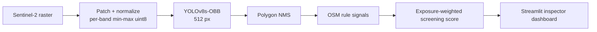

# KilnWatch BD architecture

## Screening flow

## Model card

Evaluation below is on the held-out test split of SentinelKilnDB dataset chips only. It does not describe the Bangladesh raster pilot or field accuracy.

| Metric | Result |
|---|---:|
| mAP50 | 0.752 |
| mAP50-95 | 0.493 |
| Precision | 0.699 |
| Recall | 0.734 |
| FCBK AP50 | 0.601 |
| Zigzag AP50 | 0.904 |

## Pilot audit

An earlier, separate manual Google Earth cross-check found visible kiln structures in 17 of 30 candidates overall and 15 of 15 above confidence 0.44. This was an exploratory review of a prior run; the cutoff was examined on the same small sample. These observations are not an unbiased accuracy estimate and do not validate the current five-district outputs.

## Stack and data

- Python 3.12
- YOLOv8 (Ultralytics)
- Google Earth Engine
- GeoPandas
- Streamlit
- pyrosm
- Folium
- SentinelKilnDB, Mondal et al., NeurIPS 2025: CC BY-NC 4.0
  ([paper](https://openreview.net/forum?id=efGzsxVSEC),
  [dataset](https://huggingface.co/datasets/SustainabilityLabIITGN/SentinelKilnDB))

The dashboard presents advisory screening candidates and rule signals for human review. Its outputs are screening results, not enforcement decisions.

## Implementation notes and limits

SentinelKilnDB supplies training chips. New Sentinel-2 composites are an inference input; `config/preprocessing.yaml` still records `preprocessing_verified: false`, and the pipeline must not be treated as calibrated for those exports. Candidate geometry is stored in WGS84. OSM feature geometry does not establish legally controlling boundaries, and the configured school, hospital, settlement, and technology signals remain unverified proxies. The model's imagery-to-label date gap and field accuracy remain unresolved. FCBK AP50 is lower than Zigzag AP50, so detections and classes require human review.
